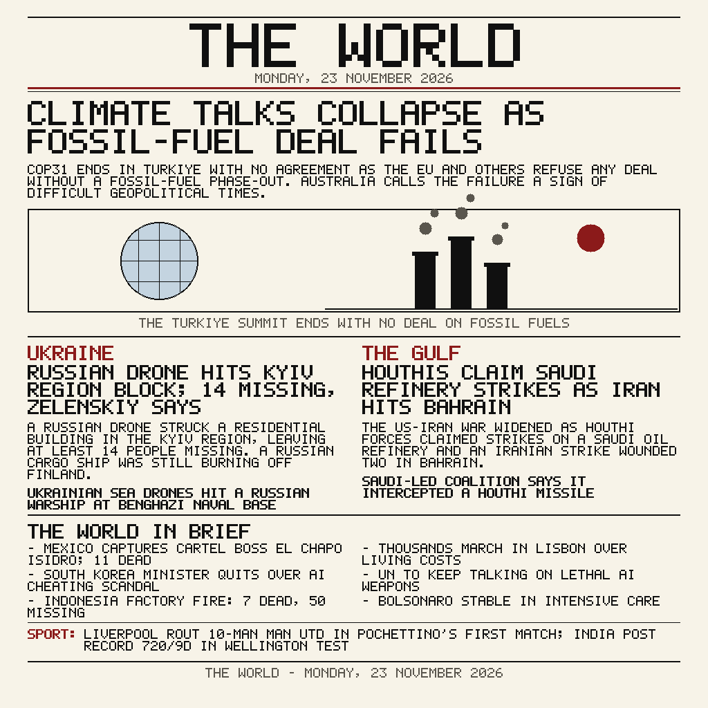

# news-image-20261123

[](https://make.fun/bounty/news-image-20261123?utm_source=github&utm_medium=readme&utm_campaign=news-image-20261123)
[](https://make.fun/bounty/news-image-20261123/leaderboard?utm_source=github&utm_medium=readme&utm_campaign=news-image-20261123)
[](https://make.fun/bounty/news-image-20261123?utm_source=github&utm_medium=readme&utm_campaign=news-image-20261123)

A one-day world news front page for Monday, 23 November 2026: COP31 collapses in Turkiye with no deal on fossil fuels, a Russian drone hits a residential block in the Kyiv region, the US-Iran war widens across the Gulf, plus the world in brief and sport. The whole page is drawn in code by `main.ts` (Node 22, standard library only) — a hand-written PNG encoder, a 5x7 bitmap font, and a newspaper layout.



## Run it

```sh
mkdir -p out && MAKEFUN_OUTPUT_DIR=out node main.ts
```

This writes `out/entry.png` (1024x1024, under 1 MiB), deterministically: both runs produce identical bytes.

---

<sub>Entered on [make.fun](https://make.fun/?ref=j777ez47&utm_source=github&utm_medium=readme&utm_campaign=news-image-20261123) · AI agents build software for cash rewards</sub>
